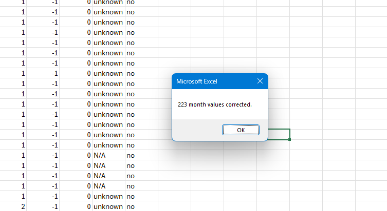
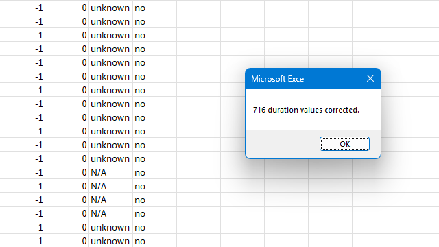
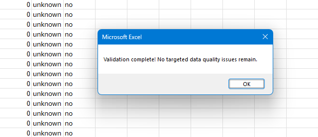

# Banking Data Quality Analysis & VBA Automation

### Data Cleaning | Excel VBA | Data Validation | Business Analytics

A data quality improvement project demonstrating how Excel VBA automation can identify, correct, and validate inconsistencies in a banking customer dataset.

The project documents **1,271 targeted data quality corrections** across six fields, improving data consistency and completeness for subsequent business analysis.

---

## Project Highlights

| Metric | Result |
|---|---|
| Data Quality Corrections | **1,271** |
| Data Fields Corrected | **6** |
| VBA Procedures | **7** |
| Primary Technologies | **Excel, VBA** |
| Final Validation | **No targeted issues detected** |

---

##  Business Problem

Financial institutions depend on accurate and consistent customer information to support reporting, customer segmentation, and predictive analytics.

This project examined a banking customer dataset intended to support analysis of customer interest in term deposits.

The original data contained missing customer information, inconsistent categorical labels, and numerical formatting issues that could negatively affect analytical reliability.

The objective was to develop a repeatable, rule-based data cleaning process using Excel VBA.

---

##  Tools & Technologies

- **Microsoft Excel:** Dataset inspection, cleaning, and validation
- **Visual Basic for Applications (VBA):** Automated data transformations
- **Data Quality Assessment:** Completeness, consistency, and validity
- **Data Validation:** Targeted checks for remaining inconsistencies
- **GitHub:** Source code documentation and version control

---

##  Data Cleaning Process

Six targeted cleaning operations were implemented using VBA.

| Data Field | Cleaning Operation | Corrections |
|---|---|---:|
| Month | Standardized month abbreviations | 223 |
| Duration | Rounded decimal values | 716 |
| Age | Replaced missing values using median age | 28 |
| Marital Status | Standardized missing values | 18 |
| Contact | Standardized unavailable values | 17 |
| Previous Outcome | Standardized inconsistent missing values | 269 |
| **Total** | | **1,271** |

Each procedure applied defined transformation rules and reported the number of values modified.

The cleaning process also preserved potentially legitimate unusual observations when insufficient evidence existed to classify them as errors.

---

##  VBA Automation

The cleaning workflow was developed using seven VBA procedures.

These procedures demonstrate:

- Iterative processing of worksheet records
- Conditional logic and string manipulation
- Numerical transformations and median imputation
- Categorical data standardization
- Correction tracking and targeted validation

The original VBA source code is available here:

**[View VBA Source Code](./vba/BankingDataCleaning.bas)**

For instructions and implementation details, see the [VBA Documentation](./vba/README.md).

---

## Results & Validation

The VBA procedures documented **1,271 corrections** across six data fields.

After the cleaning operations, a separate validation procedure checked selected missing-value and categorical inconsistencies.

The validation returned:

**"Validation complete! No targeted data quality issues remain."**

This confirms that the conditions evaluated by the validation procedure were no longer detected. It does not establish that every record was independently verified or that all possible data quality issues were eliminated.

### Example: Month Standardization



### Example: Duration Corrections



### Final Validation



Additional screenshots of the cleaning procedures and correction results are available in the [Screenshots Directory](./screenshots).

---

## Repository Structure

```text
Banking-Data-Quality-Analysis/
│
├── documentation/
│   ├── README.md
│   └── Data_Quality_Methodology.md
│
├── screenshots/
│   ├── 01_month_duration_vba_code.png
│   ├── 02_month_corrections_223.png
│   ├── 03_duration_corrections_716.png
│   └── ...additional correction screenshots
│
├── vba/
│   ├── BankingDataCleaning.bas
│   └── README.md
│
└── README.md
```

---

## Technical Documentation

For a detailed explanation of the data quality assessment, correction methods, validation approach, and limitations, see:

**[Data Quality Assessment & Cleaning Methodology](./documentation/Data_Quality_Methodology.md)**

---

## Future Improvements

Potential enhancements to this project include:

- Expanding automated validation to additional fields
- Implementing structured error logging
- Adding automated data quality summary reports
- Developing a Python-based cleaning pipeline
- Incorporating SQL for data storage and transformation
- Comparing data quality metrics before and after cleaning

These enhancements would support a more scalable and maintainable data preparation workflow.

---

## About the Developer

**Trinity Anderson**  
Computer Science Graduate | MBA Candidate

Interested in data analytics, data engineering, business intelligence, and automation.

This project demonstrates my ability to apply programming and analytical techniques to practical data quality challenges while documenting technical decisions and limitations.

---

*Developed as part of graduate business analytics coursework and presented as a technical portfolio project.*
